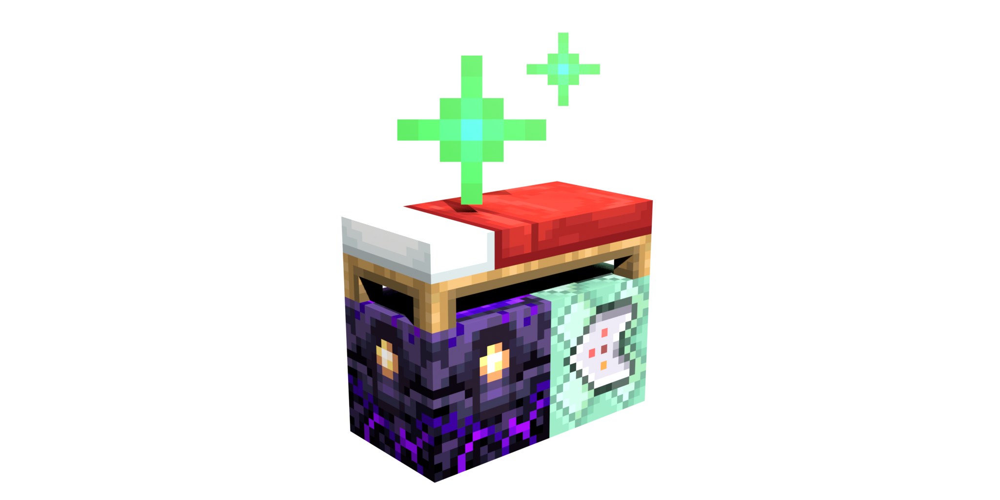

<p align="center">
  
</p>

# Proto781M's Better Spawn

**Proto781M's Better Spawn** is a NeoForge 1.21 mod that replaces the vanilla spawn
algorithm with a data-driven, per-dimension spawn and respawn system.

It is built around three ideas:

- **Data-driven spawn templates** — each dimension can define how its default spawn is
  found, using a JSON rule with a selectable search method and a fallback chain.
- **A layered respawn system** — per-dimension world spawns, per-player world spawns, and
  separate command / bed / anchor spawn slots, with a configurable priority.
- **Testable search methods** — eight built-in methods, including overworld land search,
  Nether portal-site search, cave search, floating-island search, water-world search, and
  a platform fallback, plus a sandbox command for testing rules without committing them.

## Downloads

Release `v1.1.0` contains one jar per supported branch:

| Minecraft | NeoForge | Jar |
|---|---|---|
| 1.21–1.21.1 | 21.1.265+ | `betterspawn-1.1.0+1.21.1.jar` |
| 1.21.4 | 21.4.161+ | `betterspawn-1.1.0+1.21.4.jar` |
| 1.21.11 | 21.11.48+ | `betterspawn-1.1.0+1.21.11.jar` |

## Project layout

```text
common/src/main/java        Shared code compiled for every Minecraft version
common/src/main/resources   Shared assets, data pack defaults, and license
common/src/main/templates   Shared neoforge.mods.toml template
versions/1.21.1             NeoForge 21.1 code differences
versions/1.21.4             NeoForge 21.4 code differences
versions/1.21.11            NeoForge 21.11 code differences
```

Build all supported versions:

```text
./gradlew buildAll
```

Build or run one version:

```text
./gradlew :versions:1.21.1:build
./gradlew :versions:1.21.11:runClient
```

## Documentation

Usage, commands, template reference, configuration, diagnostics, and build instructions are
kept in the **[Wiki](https://github.com/Nacano12345/MyBetterSpawnMod/wiki)**:

- [Commands](https://github.com/Nacano12345/MyBetterSpawnMod/wiki/Commands)
- [Spawn templates](https://github.com/Nacano12345/MyBetterSpawnMod/wiki/Spawn-Templates)
- [Spawn methods](https://github.com/Nacano12345/MyBetterSpawnMod/wiki/Spawn-Methods)
- [Configuration](https://github.com/Nacano12345/MyBetterSpawnMod/wiki/Configuration)
- [Experimental spawn dimension](https://github.com/Nacano12345/MyBetterSpawnMod/wiki/Spawn-Dimension)
- [Diagnostics](https://github.com/Nacano12345/MyBetterSpawnMod/wiki/Diagnostics)
- [Building from source](https://github.com/Nacano12345/MyBetterSpawnMod/wiki/Building)
- [Architecture](https://github.com/Nacano12345/MyBetterSpawnMod/wiki/Architecture)

## Requirements

- Minecraft 1.21.11
- NeoForge 21.11.48 or newer
- Java 21

## Status

Source is available and builds as `betterspawn-1.1.0+1.21.11.jar`. Some features are experimental;
see the Wiki for details and limitations.

## Logos

- [Transparent logo](docs/logos/betterspawn-transparent.png)
- [Wide banner](docs/logos/betterspawn-banner.png)
- [Dirt background](docs/logos/betterspawn-dirt.png)
- [Sky background](docs/logos/betterspawn-sky.png)

## License

This project is source-available under the **PolyForm Noncommercial License 1.0.0**.
You may view, download, modify, and distribute it for noncommercial purposes only.
Commercial use is not permitted. See [LICENSE](LICENSE) for the full terms.

This is not an OSI-approved open-source license.
